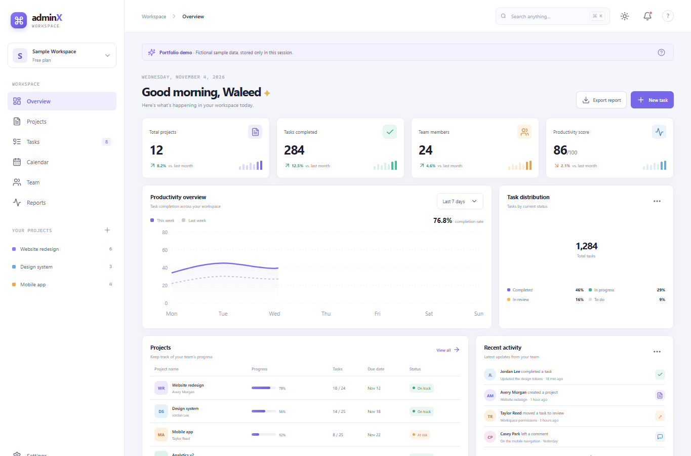

# AdminX Dashboard

An independent portfolio showcase concept for project operations and team administration. This is newly built demo work, not a previous client project. All names, emails, metrics, projects, and activity shown in the interface are fictional sample data.



## Run locally

From the repository root:

```bash
npm install
npm run dev --workspace adminx-dashboard
```

Open [http://localhost:3001](http://localhost:3001).

To build the standalone app:

```bash
npm run build --workspace adminx-dashboard
npm run start --workspace adminx-dashboard
```

## Features

- Dashboard overview with responsive area and donut charts; reports include bar, line, and radar visualizations.
- Projects view with progress, milestones, and sample team assignments.
- Kanban task board with drag and drop, status controls, task creation, priority, and search.
- Team directory with sorting, filtering, pagination, local member create/update/delete, and CSV export.
- SQLite-backed persistence for member CRUD and task creation/status changes while running in local development; data survives refreshes and server restarts.
- In public production builds, the unauthenticated SQLite API is disabled. Interactions use in-browser demo state so visitors never share a writable database.
- Monthly calendar with event create/update/delete and year-aware month navigation.
- Reports view with charts and browser print-to-PDF.
- Chart skeletons while client-side visualizations hydrate, three appearance themes, responsive navigation, notifications, focus styles, and reduced-motion support.
- Sample data notice in the app; no credentials or external service are required.

## Stack

Next.js App Router, React, TypeScript, Node.js built-in SQLite, Recharts, TanStack Table, Zustand, and Lucide icons. Use Node.js 22.13 or newer.

## Screenshots

See `screenshots/overview.png` for the browser-reviewed desktop showcase.

## Data and limitations

In local development, the API initializes fictional seed rows in `.data/adminx.sqlite`. Member CRUD and task changes are stored there; calendar changes remain in browser memory. The API is disabled in production because it has no authentication or tenant isolation; public demo interactions stay in the visitor's browser. Keep the database file private; `.data/` and SQLite artifacts are ignored by Git. CSV export is generated locally; PDF export uses the browser print dialog.

## Tech stack badges

     

## Environment variables

No environment variables are required. The local SQLite database is created under .data and remains on this machine.
