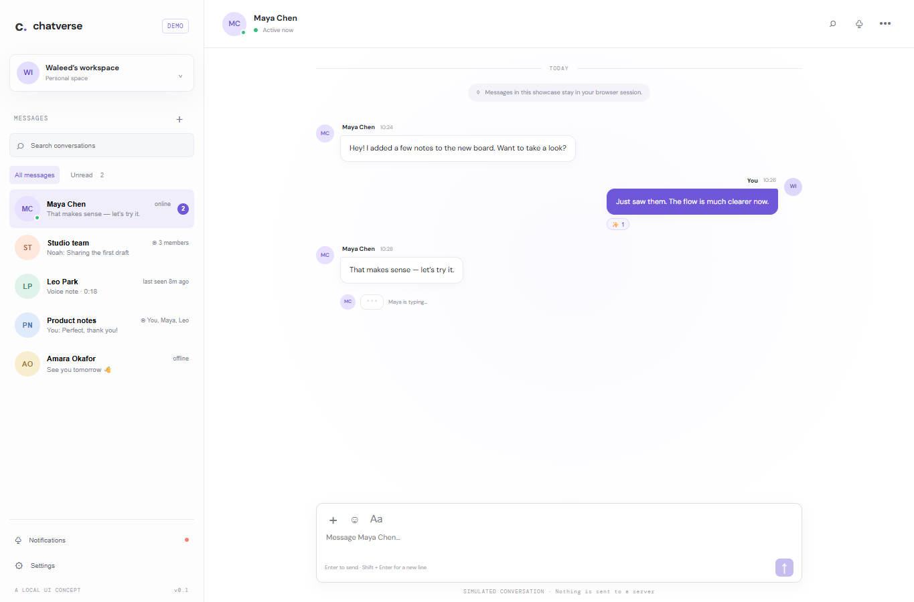

# ChatVerse

A local chat interface showcase. Contacts, message history, typing state, and conversation metadata are fictional sample data. Sending, reactions, and creating conversations work in page state only and reset when the app reloads.

## Run locally

From the workspace root, run `npm install`, then `npm run dev --workspace=chatverse` and open `http://localhost:3003`. Production commands: `npm run build --workspace=chatverse`, then `npm run start --workspace=chatverse`.

## Features

- Responsive conversation list, local search, and mobile navigation.
- Local message composition, keyboard send, emoji insertion, reaction toggles, and new conversation flow.
- Local file-name preview. Files are not uploaded or stored.
- Clearly visible disclosure that messages are simulated and not sent.

## Scope

No accounts, server, database, Socket.IO connection, Cloudinary upload, push notifications, or cross-device persistence are configured. This independent demo does not claim real-time messaging. Screenshots and live links will be added only after visual review and an approved deployment.

## Tech stack badges

  

## Screenshots

## Environment variables

No environment variables are required. This showcase uses local sample data and runs without paid APIs or external credentials.
