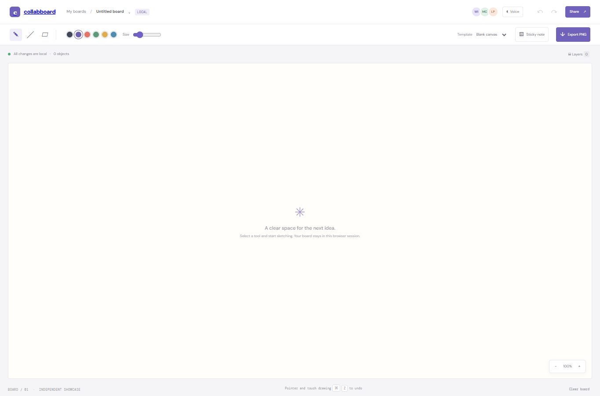

# CollabBoard

A standalone canvas showcase with working pointer/touch drawing, line and eraser tools, sticky-note text, undo/redo, board backgrounds, and PNG export. It is a local single-user board; it does not provide real-time shared editing.

## Run locally

From the workspace root, run `npm install`, then `npm run dev --workspace=collabboard` and open `http://localhost:3008`. For production, run `npm run build --workspace=collabboard` and `npm run start --workspace=collabboard`.

## Features

- Draw, erase, and sketch a line on a responsive canvas; tune color and brush size.
- Add text notes, undo/redo strokes, switch board templates, and export the board as PNG.
- Touch input supported through pointer events.

## Scope

There is no room service, shared link state, Socket.IO, MongoDB persistence, voice/WebRTC, synchronized layers, or board autosave. The share control copies the local demo URL only. Board contents stay in page memory and reset when reloaded.

## Tech stack badges

   

## Screenshots

## Environment variables

No environment variables are required. This showcase uses local sample data and runs without paid APIs or external credentials.
