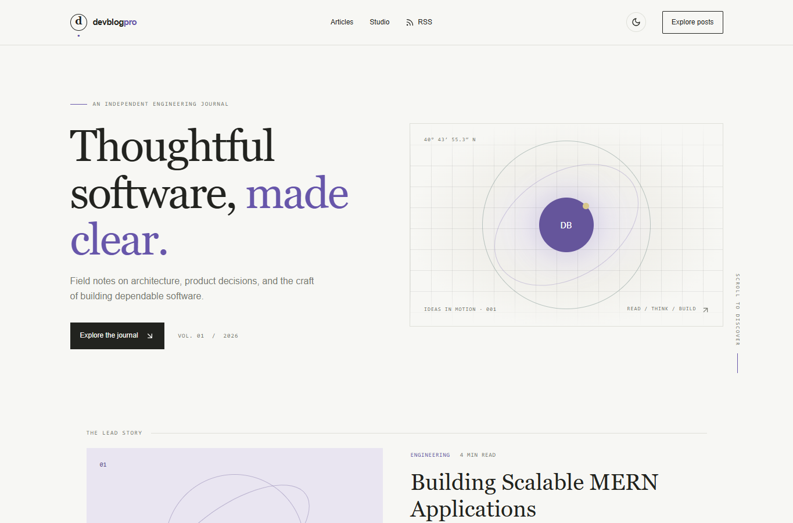

# DevBlog Pro

An independently runnable blog and editorial studio concept built for the portfolio showcase. The articles and studio metrics are original sample content; they do not represent client work, personal biography, or real publication analytics.



## Run locally

From the repository root:

```sh
npm install
npm run dev --workspace=devblog-pro
```

Open `http://localhost:3002`. To build and run the production version, use `npm run build --workspace=devblog-pro` followed by `npm run start --workspace=devblog-pro`.

## Included

- Responsive editorial home and MDX article pages with generated table of contents, metadata, and social preview images.
- Client-side article search and category filtering, light/dark theme preference, RSS feed, and read progress.
- Reading summaries and topic suggestions use local previews by default. An optional server-side OpenAI Responses API route is disabled unless explicitly enabled and configured; article text is sent to the provider only when enabled.
- Nested comments stored in the current browser's local storage; comments are not uploaded or shared.
- A studio dashboard concept with clearly marked illustrative metrics.

## Boundaries

This remains an independent portfolio showcase. It has no authentication, database, server-side authoring, email newsletter, comment moderation, or analytics collection. The optional AI route requires `OPENAI_ENABLED=true`, `OPENAI_API_KEY`, and `OPENAI_MODEL` in `projects/devblog-pro/.env.local`; it is off by default, and requests can incur API charges. Start from `.env.example` and never commit credentials. RSS links are relative because no approved public domain is configured. Search engines are disallowed by `robots.txt` and metadata until the showcase is ready for public review. Configure a verified canonical URL and enable indexing only after an approved deployment decision.

## Tech stack badges

   

## Screenshots


## Environment variables

Configure projects/devblog-pro/.env.local from the project .env.example. OPENAI_ENABLED defaults to false; OPENAI_API_KEY and OPENAI_MODEL are only needed for optional AI requests. Enabling provider requests may incur charges; local previews work without it.
