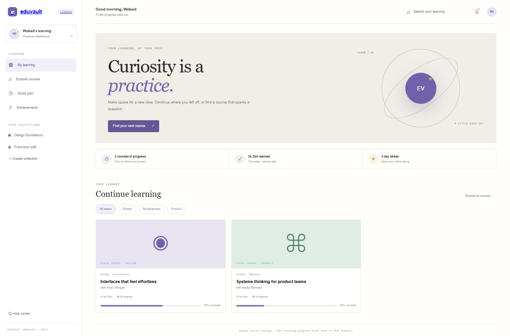

# EduVault

A responsive learning platform showcase with a sample course catalog, learner dashboard, progress preview, and local knowledge check. The instructors, courses, and learner stats are fictional sample content.

## Run locally

From the workspace root, run `npm install`, then `npm run dev --workspace=eduvault-lms` and open `http://localhost:3006`. For production, run `npm run build --workspace=eduvault-lms` and `npm run start --workspace=eduvault-lms`.

## Local API

In a second terminal, run `npm run api --workspace=eduvault-lms` to start the Express API at `http://127.0.0.1:4106`. Check `/api/health`; `/api/courses` lists fictional courses and `/api/enrollments` stores local enrollment previews. Data persists in `server/data.json`.

## Features

- Course search and category filters, sample learning dashboard, and course details.
- Add courses to a local learning list and update progress with a short quiz preview.
- Responsive desktop and mobile layouts.

## Scope

The local Express API serves fictional courses and stores sample enrollment records in JSON. It does not provide login, video hosting, Stripe checkout, real student data, or instructor payments. Progress resets on reload; sample stats are illustrative, not measured outcomes.

## Tech stack badges

  

## Screenshots

## Environment variables

`API_PORT` is optional and defaults to `4106`. No external credentials or paid APIs are needed.
