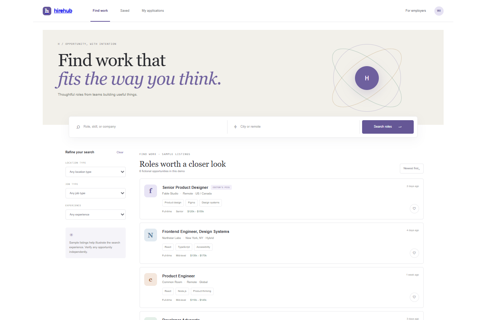

# HireHub

A responsive job discovery interface concept. All companies, compensation ranges, people, and vacancies are fictional sample content; none of the listings represents a real job opening.

## Run locally

From the workspace root, run `npm install`, then `npm run dev --workspace=hirehub-jobs` and open `http://localhost:3007`. For production, run `npm run build --workspace=hirehub-jobs` and `npm run start --workspace=hirehub-jobs`.

## Features

- Search sample jobs by title, company, skill, and location.
- Filter by location type, employment type, and experience level.
- Save listings and create a local application record with validation.
- View a role detail dialog with a sample application flow.

## Scope

No real employers, live job index, user accounts, résumé upload/parsing, persistent ATS, company reviews, Stripe, email alerts, or moderation backend is connected. Applications remain only in browser state and are not sent to employers. Compensation and listing details are illustrative.

## Tech stack badges

  

## Screenshots

## Environment variables

No environment variables are required. This showcase uses local sample data and runs without paid APIs or external credentials.
